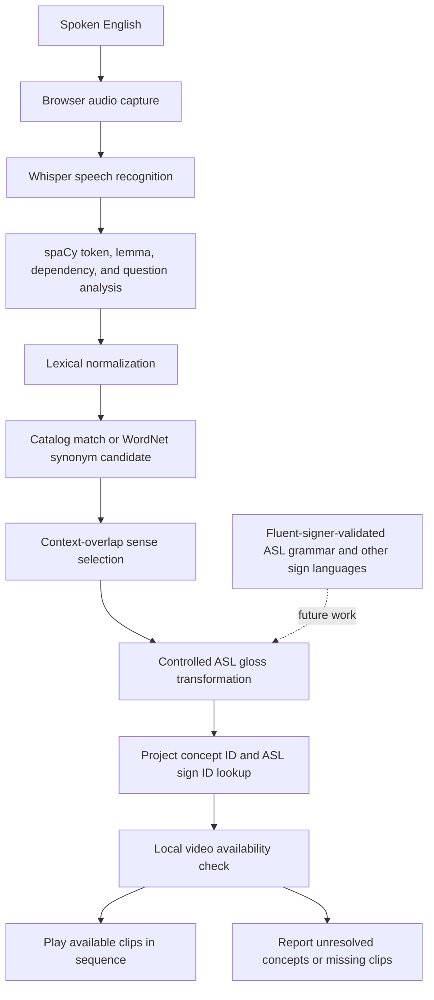

# SignBridge architecture and scope

## Implemented request flow

## What the stages actually do

1. The browser records audio and uploads it to `POST /translate`.
2. Whisper converts audio to a text transcript. Empty transcripts return a readable error.
3. spaCy tokenizes the transcript and returns lemmas, parts of speech, dependency labels, entities, basic sentence type, and context words.
4. Lexical normalization maps supported inflections and curated English forms to the project's gloss candidates. Exact multiword catalog forms such as `every one` are collapsed to a single catalog concept before individual-word mapping.
5. Exact gloss and English-form matches resolve directly. For an unfamiliar expression, the semantic mapper uses WordNet to find catalog English forms that share an exact synset. When more than one sense is possible, it compares the context words with the WordNet sense definitions, examples, and lemmas. It accepts a candidate only when the best context match identifies one catalog concept; otherwise it preserves the expression as unresolved. This is a small lexical matching method, not a trained semantic model.
6. The ASL transformation applies the controlled rules listed in the API response. It normalizes a small set of downloaded phrase clips (for example, `BEST FRIEND`, `I NO KNOW`, and `WHAT UP`) to one catalog gloss, removes selected auxiliaries, retains negation and time glosses, and appends a `QUESTION` marker for yes/no questions. It preserves English source order outside those explicit rules.
7. Each resulting gloss is looked up in `data/sign_catalog.json`. Matching records provide SignBridge-local concept and sign IDs plus an expected video filename. The mapper checks that the file exists and marks missing or unresolved resources.
8. The interface displays the recognized sentence, gloss sequence, concept/resource mapping, and plays available clips in order. The API also returns a per-token semantic decision trace and the transformation rule set.

## Scope and limitations

- The catalog IDs are local database identifiers, not IDs from an ASL authority or standard.
- The WordNet matcher only proposes a catalog concept when an exact synset relation and context selection support it. WordNet sense definitions and simple word overlap can still select the wrong meaning; review its per-token trace and unresolved decisions.
- A one-word-to-one-clip mapping does not represent all meanings, inflections, non-manual signals, spatial grammar, or signer variation in ASL.
- The target-language transformer is a controlled gloss rule set, not a complete or fluent ASL grammar. It preserves source order except for explicit rules, so users must not treat the sequence as an accurate full-sentence ASL translation.
- The available clips constrain output. A missing mapping or resource is reported; playback may therefore contain only part of the gloss sequence.
- The expanded catalog has 84 local entries. Phrase clips are enabled only for the explicit phrase rules; other multiword clips are not automatically composed from arbitrary sentences.
- WordNet is optional at runtime. The installation guide downloads its English corpus; without it, exact catalog matches still work and unmatched words stay unresolved.
- Additional sign languages, validated ASL grammar, richer sense-level concept definitions, and evaluation with fluent signers remain future work.

## Response fields

`POST /translate` returns the recognized `text`, spaCy `analysis`, ordered `sign_sequence`, per-token `semantic_mapping` trace, `target_transformation` and its limitations, a compact `concept_sequence`, expanded `signs` mapping/resource records, catalog counts, and `translation_method`. For every gloss, the expanded mapping indicates whether the concept/sign mapping and playable local resource were resolved.
